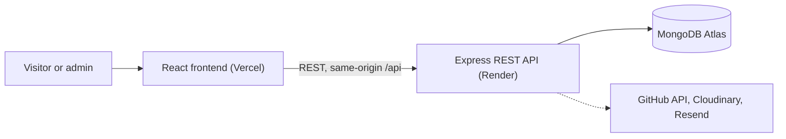

<div align="center">

# Personal Portfolio

**Dipak Hore** · Full-Stack Developer | AI/ML Enthusiast

A full-stack MERN portfolio with a private admin dashboard, so content is managed through a REST API instead of being hard-coded in the source.

### [View the live website](https://my-portfolio-sooty-mu-80.vercel.app)


[](https://github.com/dipakhore-dev/MY-PORTFOLIO/actions/workflows/ci.yml)


</div>

## Overview

This is my personal portfolio and a complete MERN application at the same time. Visitors see a single-page site with my projects, experience, education, live GitHub statistics and resume. I manage all of that content from a login-protected dashboard, so a new project or an updated resume goes live without a code change or redeploy.

I built it to practise the full lifecycle of a production-style web application: a React frontend, a layered Express API, a MongoDB data model, authentication, input validation, automated tests, CI and a three-service cloud deployment.

**How the parts fit together.** The React app fetches portfolio data from the Express REST API. The API validates requests, applies authentication, and reads and writes MongoDB through Mongoose. The admin dashboard is part of the same React app, lazy-loaded under `/admin`, and talks to the same API with a session cookie.

## Live application

The best way to evaluate this project is to use it:

**[my-portfolio-sooty-mu-80.vercel.app](https://my-portfolio-sooty-mu-80.vercel.app)**

The admin dashboard is private. The screenshots below show it.

> The API runs on a free hosting plan, so the first request after a quiet period can take up to about a minute.

## Application preview

<table>
  <tr>
    <td width="50%"><br><sub><b>Homepage</b></sub></td>
    <td width="50%"><br><sub><b>Projects section with technology filter</b></sub></td>
  </tr>
  <tr>
    <td width="50%"><br><sub><b>Light theme</b></sub></td>
    <td width="50%"><br><sub><b>Admin dashboard</b></sub></td>
  </tr>
</table>

<p align="center">
  <br>
  <sub><b>Responsive mobile layout</b></sub>
</p>

## Key features

| Area | Implemented functionality |
|---|---|
| **Frontend** | Responsive single-page layout with eight sections (Hero, About, Projects, Experience, Education, GitHub, Resume, Contact) |
| | Side navigation dock that tracks the section in view, plus a top bar and mobile menu |
| | Project grid with technology filtering and a Markdown-rendered detail page per project |
| | Light and dark themes that follow the system setting and remember the visitor's choice |
| | Animated components, skeleton loading states and a custom 404 page |
| | Per-page SEO tags, Open Graph and Twitter tags, JSON-LD and a generated `sitemap.xml` |
| **Backend** | REST API split into routes, controllers, models, services, middleware and validators |
| | Joi request validation, centralised error handling, pagination and filtering |
| | Contact form with a honeypot field, database storage and optional email notification |
| | Rate limiting on login, the contact form and the API as a whole |
| **Admin dashboard** | Secure login with a JWT in an httpOnly cookie, and a password change page |
| | Create, edit and delete projects, skills, experience entries and blog posts, with draft support |
| | Markdown editor with live preview, image upload, profile editing and resume upload |
| | Message inbox with read and unread states |
| **Integrations** | GitHub REST API: repositories, stars, followers and language breakdown, cached on the server |
| | Cloudinary for image and resume storage, Resend or SMTP for contact notifications |
| | Social link previews (LinkedIn, WhatsApp, X, Slack) with correct titles and images per page |

Blog posts are written in Markdown and managed from the dashboard. Public pages for them exist at `/blog`.

## Technology stack

| Category | Technology | How it is used |
|---|---|---|
| Frontend | React.js (JavaScript), Vite | Component-based UI and build tooling |
| Frontend | Tailwind CSS | Styling, responsive layout and theming |
| Frontend | React Router, React Hook Form, Axios | Routing, form handling and API calls |
| Frontend | Framer Motion, Lucide React | Animation and icons |
| Backend | Node.js, Express.js | REST API |
| Database | MongoDB (Atlas), Mongoose | Data storage and schema modelling |
| Security | JWT, bcrypt, Helmet, Joi, express-rate-limit | Authentication, password hashing, headers, validation, rate limits |
| Services | Cloudinary, Resend, GitHub REST API | File storage, email notifications, repository statistics |
| Quality | Vitest, Supertest, ESLint, Prettier, GitHub Actions | API tests, code style and CI |
| Tooling | Git and GitHub | Version control and CI hosting |
| Hosting | Vercel, Render, MongoDB Atlas | Frontend, API and database |

## Application architecture



**Data flow.** The frontend never talks to the database. Every read and write goes through the Express API, which validates input, enforces access rules and uses Mongoose models to reach MongoDB.

**Authentication and admin access.** The admin logs in with email and password. The API verifies the password against a bcrypt hash and issues a signed JWT in an httpOnly cookie. Protected endpoints check that cookie on every request. There is no public registration, and the single admin account is created by a seed script. The `/admin` pages in the React app redirect unauthenticated visitors to the login page, while the API itself enforces access.

**Public versus admin data.** Public list and detail endpoints are open, but drafts are returned only to a logged-in admin. All create, update, delete, upload and message endpoints require authentication.

**External integrations.** The API calls the GitHub REST API on behalf of the browser, aggregates the results and caches them for an hour. Uploaded images and the resume go to Cloudinary, and contact notifications go out through Resend or SMTP when configured.

**Production topology.** Vercel serves the static frontend and proxies `/api` to the API on Render, which connects to MongoDB Atlas.

## Technical highlights

- **Component-based frontend.** Reusable layout, section and UI components. The admin app and the heavier pages are lazy-loaded, so public visitors do not download the dashboard.
- **Layered REST API.** Routes, controllers, services, middleware and validators are separated. A generic CRUD controller factory serves projects, skills, experience and posts, so pagination, slugs, draft visibility and image clean-up behave the same everywhere.
- **Authentication and protected endpoints.** JWT with a pinned algorithm in an httpOnly cookie, bcrypt hashing, a uniform login error and a dummy hash comparison for unknown emails, with middleware that guards every admin route.
- **Validation as a security layer.** Joi schemas strip unknown fields and reject unexpected types, which prevents mass assignment and NoSQL operator injection with the same mechanism.
- **Safe uploads.** Size limits, a type allowlist and file-signature checks instead of trusting the browser's MIME type. SVG is not accepted.
- **Consistent error handling.** One error handler maps validation, cast, duplicate-key, token and upload errors to clear responses and hides internal details in production.
- **Database design.** Mongoose schemas with indexes for the common queries, unique slugs, and draft and publish states.
- **Automated tests and CI.** An API test suite built with Vitest and Supertest covers authentication, validation, permissions, uploads, rate limiting, the GitHub endpoint, the sitemap and link previews. GitHub Actions runs it against a MongoDB service and also builds the client on every push.

## Development challenges and solutions

These are engineering decisions recorded in the project's code and documentation:

| Challenge | Solution |
|---|---|
| Browsers such as Safari block cookies between two different domains, which breaks an httpOnly login cookie when the frontend and API are hosted separately | The frontend host proxies `/api` to the API, so every request is same-origin and the cookie stays first-party |
| Social link-preview crawlers do not run JavaScript, so a React single-page app shows the same preview for every page | The frontend host rewrites requests from known crawler user agents to API routes that return small HTML pages with the right Open Graph tags |
| The anonymous GitHub API rate limit would be exhausted if every visitor's browser called it | The API fetches the data, caches it for an hour and serves the last good result if GitHub is unavailable |
| The free hosting disk is not persistent, so uploaded files would be lost | Images and the resume are stored in Cloudinary, with a local-disk fallback for development |
| The free hosting plan blocks outbound SMTP | Contact notifications use Resend's HTTPS API, and messages are always saved to the database first |

## Project structure

```text
.
├── client/            React frontend (Vite, Tailwind CSS)
│   └── src/
│       ├── admin/         Admin dashboard (pages, components, auth context)
│       ├── components/    Layout, page sections and shared UI
│       ├── pages/         Home, project detail, blog, 404
│       └── api/           API client and endpoint helpers
├── server/            Express REST API
│   ├── src/
│   │   ├── routes/        Endpoint definitions
│   │   ├── controllers/   Request handlers
│   │   ├── models/        Mongoose schemas
│   │   ├── middleware/    Auth, validation, errors, uploads, rate limits
│   │   ├── services/      GitHub, email and storage integrations
│   │   └── validators/    Joi schemas
│   └── tests/             API test suite
├── docs/screenshots/  Images used in this README
└── .github/workflows/ Continuous integration
```

## Future enhancements

**Completed:** everything described above is implemented and in the deployed application.

**Planned (not yet implemented):**

- Component and end-to-end tests for the React app
- Lint checks in the CI pipeline
- Password-reset flow and server-side token revocation
- Pagination in the admin tables

## Author

**Dipak Hore**: Full-Stack Developer | AI/ML Enthusiast

- Portfolio: [my-portfolio-sooty-mu-80.vercel.app](https://my-portfolio-sooty-mu-80.vercel.app)
- GitHub: [github.com/dipakhore-dev](https://github.com/dipakhore-dev)
- LinkedIn: [linkedin.com/in/dipak-hore](https://www.linkedin.com/in/dipak-hore)

## License

This repository is released under the [MIT License](LICENSE), which governs any use of the source code.
