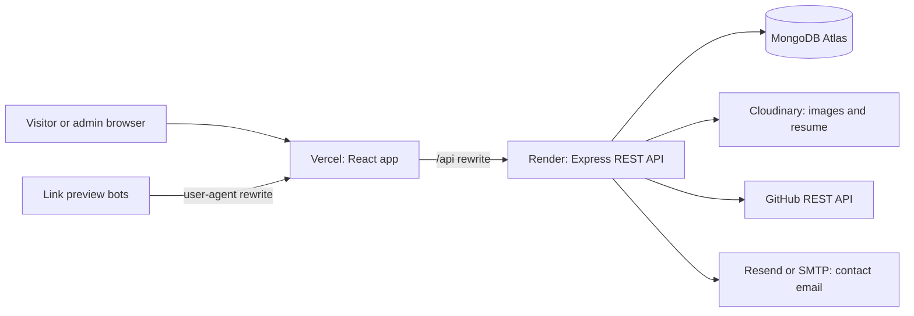

<div align="center">

# Dipak Hore | Portfolio

A full-stack MERN portfolio with a protected admin dashboard. Projects, skills, experience, blog posts, profile details and the resume are managed from the browser and served through a REST API, so content changes do not need a redeploy.

[**Live site**](https://my-portfolio-sooty-mu-80.vercel.app) · [GitHub repository](https://github.com/dipakhore979/MY-PORTFOLIO) · [Deployment guide](docs/DEPLOYMENT.md) · [Report an issue](https://github.com/dipakhore979/MY-PORTFOLIO/issues)

[](https://github.com/dipakhore979/MY-PORTFOLIO/actions/workflows/ci.yml)


</div>

## Contents

- [Overview](#overview)
- [Live demo](#live-demo)
- [Screenshots](#screenshots)
- [Key features](#key-features)
- [Technology stack](#technology-stack)
- [System architecture](#system-architecture)
- [Project structure](#project-structure)
- [Installation and local setup](#installation-and-local-setup)
- [Environment variables](#environment-variables)
- [Authentication and authorization](#authentication-and-authorization)
- [API documentation](#api-documentation)
- [Testing and quality](#testing-and-quality)
- [Deployment](#deployment)
- [Security considerations](#security-considerations)
- [Future improvements](#future-improvements)
- [Author](#author)
- [License](#license)

## Overview

This repository is my personal portfolio and a complete MERN application at the same time. Visitors get a single-page site with my projects, experience, education, live GitHub statistics and resume. I manage that content through a login-protected dashboard at `/admin`.

A static portfolio keeps its content in the source code, so every edit means a commit and a deploy. Here the content lives in MongoDB and is served by an Express API. Adding a project, publishing a post or replacing the resume takes effect immediately, and incoming contact messages are stored in the database and shown in an admin inbox.

The project was also built to practise production-style full-stack work: layered backend code, request validation, authentication, rate limiting, automated API tests, CI and a three-service deployment.

## Live demo

**https://my-portfolio-sooty-mu-80.vercel.app**

The admin dashboard is at `/admin`. It is private and requires the admin account, which is created with the seed script and is not shared publicly.

> The API runs on a free Render plan, so the first request after a period of inactivity can take up to about a minute while the service wakes up.

## Screenshots

<table>
  <tr>
    <td width="50%"><br><sub><b>Homepage</b></sub></td>
    <td width="50%"><br><sub><b>Projects section</b></sub></td>
  </tr>
  <tr>
    <td width="50%"><br><sub><b>Light mode</b></sub></td>
    <td width="50%"><br><sub><b>Admin dashboard</b></sub></td>
  </tr>
</table>

<p align="center">
  <br>
  <sub><b>Mobile view</b></sub>
</p>

## Key features

### Public portfolio

- Single-page home with eight sections: Hero, About, Projects, Experience, Education, GitHub, Resume and Contact
- Side navigation dock that tracks the section in view, plus a top bar and a mobile menu
- Project grid with filtering by technology, and a detail page for each project rendered from Markdown
- Blog list and post pages at `/blog` and `/blog/:slug` (not linked from the home page navigation; posts are managed from the admin dashboard)
- GitHub section showing public repositories, stars, followers and a language breakdown
- Resume section with an embedded PDF preview and download
- Contact form with client and server validation and a honeypot field
- Light and dark themes, initialised from the system setting and remembered in `localStorage`
- Per-page SEO tags, Open Graph and Twitter tags, JSON-LD for the home page, a generated `sitemap.xml` and a custom 404 page
- Link previews with correct titles and images for projects and posts when shared on LinkedIn, WhatsApp, X, Slack and similar services

### Admin dashboard

- Login page and a password change page
- Create, edit and delete projects, skills, experience entries and blog posts, with draft support
- Markdown editing with live preview for project and post content
- Image upload (Cloudinary, or local disk when Cloudinary is not configured)
- Editable profile and resume upload
- Message inbox with read and unread states and delete
- Dashboard overview page

### Backend and API

- REST API organised into routes, controllers, models, services, middleware and validators
- A shared CRUD controller factory used by projects, skills, experience and posts
- Joi validation on write routes and on list query parameters
- Pagination and filtering on list endpoints (`page`, `limit`, `tech`, `tag`, `featured`, `category`, `type`)
- GitHub data fetched server-side, cached in memory for one hour, with stale data served if GitHub is unavailable
- Contact messages stored in MongoDB, with an optional email notification through Resend or SMTP
- Dynamic `sitemap.xml` built from published projects and posts
- `/api/health` endpoint, graceful shutdown handling and a post-deploy smoke test script

### Security and authentication

- JWT sent in an httpOnly cookie, verified with a pinned algorithm (HS256)
- bcrypt password hashing with a cost factor of 12
- Rate limiting on login, the contact form and the API as a whole
- Helmet security headers, CORS allowlist, request body size limit
- Uploads limited to 5 MB and validated by file signature
- No public registration route

## Technology stack

| Layer | Technology | Role |
|---|---|---|
| Frontend | React 18, Vite 6 | Component-based UI, fast dev server and production build |
| Frontend | React Router 6 | Client-side routing, lazy-loaded admin and detail pages |
| Frontend | Tailwind CSS 3, `@tailwindcss/typography` | Styling, theming and rendered Markdown typography |
| Frontend | Framer Motion, Lucide React | Animation and icons |
| Frontend | React Hook Form, Axios | Form handling and API requests with credentials |
| Frontend | react-markdown, remark-gfm, react-helmet-async | Markdown rendering and per-page head tags |
| Backend | Node.js (>= 18), Express 4 | REST API |
| Backend | Mongoose 8 | Data modelling for MongoDB |
| Backend | Joi | Request validation |
| Backend | jsonwebtoken, bcryptjs, cookie-parser | Authentication and password hashing |
| Backend | helmet, cors, express-rate-limit, compression, morgan | Security headers, CORS, rate limits, compression and logging |
| Backend | multer, Cloudinary SDK | File uploads and image storage |
| Backend | Nodemailer, Resend HTTP API | Contact email notifications (optional) |
| Database | MongoDB Atlas | Primary data store |
| Testing | Vitest, Supertest | API test suite |
| Tooling | ESLint 9, Prettier 3, GitHub Actions | Linting, formatting and CI |
| Hosting | Vercel, Render, MongoDB Atlas | Frontend, API and database |

## System architecture



- **Frontend.** A React single-page app built with Vite and hosted on Vercel. It fetches content from the API and lazy-loads the admin dashboard so public visitors never download it.
- **API.** An Express application that exposes REST endpoints under `/api`. It handles validation, authentication, rate limiting, uploads and integrations.
- **Database.** MongoDB (Atlas in production) holds users, profile, projects, skills, experience, posts and messages through Mongoose models.
- **Authentication.** The API issues a signed JWT in an httpOnly cookie. Protected routes verify it on every request.
- **Same-origin proxy.** `client/vercel.json` rewrites `/api/*` and `/sitemap.xml` to the Render service, so the browser only talks to one origin. This keeps the login cookie first-party, which matters for browsers that block cross-site cookies.
- **Link previews.** Social crawlers do not run JavaScript, so `vercel.json` rewrites requests from known crawler user agents to `/api/share/*` routes. Those return a small HTML page with the correct Open Graph tags.
- **GitHub integration.** The API calls the GitHub REST API, aggregates the result and caches it for an hour. The browser never calls GitHub directly.
- **Hosting.** Vercel serves the frontend, Render runs the API (defined in `render.yaml`), and MongoDB Atlas hosts the database. Cloudinary and Resend are optional external services.

## Project structure

```text
.
├── .github/workflows/ci.yml     CI: API tests and client build
├── client/                      React frontend (Vite)
│   ├── public/                  Static assets, robots.txt, SPA redirects
│   ├── src/
│   │   ├── admin/               Dashboard: pages, components, auth context
│   │   ├── api/                 Axios client and endpoint helpers
│   │   ├── components/          Layout, page sections, shared UI
│   │   ├── config/site.js       Static site details
│   │   ├── context/             Theme and profile state
│   │   ├── hooks/               Data fetching, scroll tracking
│   │   └── pages/               Home, project detail, blog, 404
│   ├── vercel.json              Rewrites, link-preview routing, headers
│   ├── netlify.toml             Equivalent configuration for Netlify
│   └── .env.example
├── server/                      Express API
│   ├── src/
│   │   ├── config/              Environment parsing and DB connection
│   │   ├── controllers/         Request handlers (including the CRUD factory)
│   │   ├── middleware/          Auth, validation, errors, uploads, rate limits
│   │   ├── models/              Mongoose schemas
│   │   ├── routes/              Route definitions
│   │   ├── seed/                Seed script (admin user and starter content)
│   │   ├── services/            GitHub, mailer, storage integrations
│   │   ├── utils/               Tokens, slugs, file type detection, helpers
│   │   └── validators/          Joi schemas
│   ├── tests/                   Vitest and Supertest suites
│   └── .env.example
├── docs/
│   ├── DEPLOYMENT.md            Deployment walk-through
│   └── screenshots/
├── scripts/smoke-test.mjs       Post-deploy checks
├── render.yaml                  Render blueprint for the API
└── package.json                 Root helper scripts
```

## Installation and local setup

**Prerequisites:** Node.js 18 or newer, and either a local MongoDB instance or a free [MongoDB Atlas](https://www.mongodb.com/atlas) cluster.

**1. Clone the repository and install dependencies**

```bash
git clone https://github.com/dipakhore979/MY-PORTFOLIO.git
cd MY-PORTFOLIO
npm run install:all
```

**2. Configure the API**

```bash
cd server
cp .env.example .env        # Windows: copy .env.example .env
```

Set at least `MONGODB_URI`, `JWT_SECRET`, `ADMIN_EMAIL` and `ADMIN_PASSWORD` in `server/.env`. The admin password must be at least 10 characters. See [Environment variables](#environment-variables).

**3. Create the admin user and starter content**

```bash
npm run seed
```

> `npm run seed` replaces projects, skills, experience and posts with starter data. On a database that already holds real content, run `npm run seed:admin` instead, which only creates the admin user and profile.

**4. Start the backend** (http://localhost:5000)

```bash
npm run dev
```

**5. Configure and start the frontend** in a second terminal (http://localhost:5173)

```bash
cd client
cp .env.example .env        # Windows: copy .env.example .env
npm run dev
```

**6. Open the app**

- Public site: http://localhost:5173
- Admin dashboard: http://localhost:5173/admin (sign in with `ADMIN_EMAIL` and `ADMIN_PASSWORD`)
- API health check: http://localhost:5000/api/health

### Available scripts

| Location | Command | Purpose |
|---|---|---|
| root | `npm run install:all` | Install server and client dependencies |
| root | `npm run dev:server` / `npm run dev:client` | Start either app from the repository root |
| root | `npm run seed` | Run the server seed script |
| root | `npm run build` | Production build of the client |
| root | `npm run lint` | Lint server and client |
| root | `npm test` | Run the API tests |
| root | `npm run smoke -- <api-url>` | Post-deploy smoke test, e.g. `http://localhost:5000/api` |
| server | `npm run dev` / `npm start` | API with nodemon, or plain `node` |
| server | `npm run seed` / `seed:admin` / `seed:destroy` | Load starter data, create only the admin, or clear content |
| server | `npm test` / `npm run test:watch` | Run the test suite once, or in watch mode |
| client | `npm run dev` / `build` / `preview` | Dev server, production build, preview of the build |
| both | `npm run lint` / `npm run format` | ESLint, Prettier |

## Environment variables

Never commit `.env` files. They are listed in `.gitignore`. The full, commented list is in [`server/.env.example`](server/.env.example) and [`client/.env.example`](client/.env.example).

### Server (`server/.env`)

| Variable | Required | Description |
|---|---|---|
| `MONGODB_URI` | Yes | MongoDB connection string. The server will not start without it. |
| `JWT_SECRET` | Yes | Secret used to sign tokens. Must be at least 32 characters in production. |
| `CLIENT_URL` | Production | Allowed frontend origin(s) for CORS, comma-separated, no trailing slash. Defaults to `http://localhost:5173`. |
| `ADMIN_EMAIL`, `ADMIN_PASSWORD` | For seeding | Credentials for the first admin user. `ADMIN_NAME` is optional. |
| `NODE_ENV`, `PORT` | No | Environment mode and port (default `5000`). |
| `JWT_EXPIRES_DAYS` | No | Token and cookie lifetime in days (default `7`). |
| `COOKIE_SAMESITE` | No | `lax`, `strict` or `none`. Defaults to `lax` in development and `none` in production. |
| `COOKIE_DOMAIN` | No | Cookie domain, for deployments where the site and API share a parent domain. |
| `TRUST_PROXY` | No | Number of reverse proxies in front of the API (default `1`). Affects rate limiting by IP. |
| `SITE_URL` | No | Public site URL used in `sitemap.xml`. Defaults to the first `CLIENT_URL`. |
| `SERVER_URL` | No | Public API URL used to build local upload URLs. |
| `CONTACT_RECEIVER` | No | Address that receives contact notifications. |
| `RESEND_API_KEY`, `RESEND_FROM` | No | Resend email provider. |
| `SMTP_HOST`, `SMTP_PORT`, `SMTP_SECURE`, `SMTP_USER`, `SMTP_PASS`, `MAIL_FROM` | No | SMTP email provider (alternative to Resend). |
| `CLOUDINARY_CLOUD_NAME`, `CLOUDINARY_API_KEY`, `CLOUDINARY_API_SECRET` | No | Persistent image and resume storage. Without them, files go to `server/uploads`. |
| `GITHUB_USERNAME`, `GITHUB_TOKEN` | No | Override the GitHub user (otherwise taken from the profile) and raise the GitHub API rate limit. |
| `RESUME_URL` | No | If set, `/api/resume` redirects to this URL. |
| `TEST_MONGODB_URI` | Tests | Test database URI. The database name must end in `_test`. |

Contact messages are always saved to MongoDB. Email is only a notification, and it is disabled when no provider is configured.

### Client (`client/.env`)

| Variable | Required | Description |
|---|---|---|
| `VITE_API_URL` | Yes | API base URL. `http://localhost:5000/api` locally, `/api` in production behind the proxy. |
| `VITE_SITE_URL` | Recommended | Public site URL, used for canonical links and share images. |

## Authentication and authorization

**Admin login.** `POST /api/auth/login` takes an email and password. The API looks up the user, compares the password with bcrypt and returns the user's public fields. When the email does not exist it still runs a dummy bcrypt comparison, so response time does not reveal whether an account exists.

**JWT.** On success the API signs a JWT (`HS256`, payload `sub` = user id) that expires after `JWT_EXPIRES_DAYS` (7 by default). Verification pins the algorithm to HS256.

**Cookie handling.** The token is stored in a cookie named `token` with `httpOnly` set, `path=/`, and the same lifetime as the token. `Secure` is set in production and whenever `SameSite=None`. `SameSite` comes from `COOKIE_SAMESITE`. The frontend sends it with `withCredentials: true`, and `POST /api/auth/logout` clears it.

**Protected routes.**

- *API:* the `protect` middleware reads the cookie, verifies the token, loads the user from the database and rejects the request with `401` if anything fails. Write routes, message routes, upload routes, `GET /auth/me` and `PUT /auth/password` all use it.
- *Draft visibility:* the `optionalAuth` middleware attaches the user when a valid cookie exists and otherwise continues anonymously. Public list and detail endpoints use it so that unpublished projects and posts are returned only to a logged-in admin.
- *Frontend:* `ProtectedRoute` redirects unauthenticated visitors under `/admin` to `/admin/login`. This is a usability layer only. The API enforces access.

**Authorization model.** There is a single role, `admin`, and no public registration route. The admin account is created by the seed script. Any authenticated user is therefore an admin, and the code does not implement per-role permission checks.

**Password change.** `PUT /api/auth/password` requires the current password, rejects a new password identical to the old one, and re-issues the cookie. Passwords must be at least 10 characters.

## API documentation

Base path: `/api`. "Admin" means a valid session cookie is required. Responses use the shape `{ success, data | message }`.

| Method | Endpoint | Auth | Description |
|---|---|---|---|
| GET | `/health` | Public | Service status and uptime |
| POST | `/auth/login` | Public (rate limited) | Log in and set the auth cookie |
| POST | `/auth/logout` | Public | Clear the auth cookie |
| GET | `/auth/me` | Admin | Current user |
| PUT | `/auth/password` | Admin | Change password |
| GET | `/projects`, `/skills`, `/experience`, `/posts` | Public | List items. Drafts are returned only to an admin. |
| GET | `/projects/:idOrSlug`, `/skills/:idOrSlug`, `/experience/:idOrSlug`, `/posts/:idOrSlug` | Public | Get one item by id or slug (draft items only for an admin) |
| POST | `/projects`, `/skills`, `/experience`, `/posts` | Admin | Create an item |
| PUT | `/projects/:id`, `/skills/:id`, `/experience/:id`, `/posts/:id` | Admin | Update an item |
| DELETE | `/projects/:id`, `/skills/:id`, `/experience/:id`, `/posts/:id` | Admin | Delete an item |
| GET | `/profile` | Public | Site profile |
| PUT | `/profile` | Admin | Create or update the profile |
| POST | `/contact` | Public (rate limited) | Submit a contact message |
| GET | `/messages`, `/messages/:id` | Admin | List or read messages |
| PATCH | `/messages/:id` | Admin | Mark a message read or unread |
| DELETE | `/messages/:id` | Admin | Delete a message |
| POST | `/upload/image` | Admin | Upload an image (field `image`) |
| POST | `/upload/resume` | Admin | Upload the resume PDF (field `file`) |
| GET | `/resume`, `/resume/info` | Public | Download or preview the resume, and check whether one exists |
| GET | `/github` | Public | Cached GitHub summary |
| GET | `/sitemap.xml` | Public | Generated sitemap |
| GET | `/share/home`, `/share/blog`, `/share/projects/:slug`, `/share/posts/:slug` | Public | HTML pages with Open Graph tags for link-preview crawlers |

List endpoints accept `page` and `limit` (1 to 100). Projects also accept `tech` and `featured`, posts accept `tag`, and skills and experience accept `category` and `type`. Messages accept `unread`.

Rate limits: 300 requests per 15 minutes per IP for the API as a whole, 10 login attempts per 15 minutes, and 5 contact messages per hour.

## Testing and quality

**Automated tests.** The API has a Vitest and Supertest suite in `server/tests/` covering authentication and token handling, request validation, permissions on protected routes, draft visibility, uploads, rate limiting, contact and message handling, profile updates, the GitHub endpoint, the sitemap and link-preview pages.

```bash
# from the repository root, or from server/
npm test
```

The tests need a running MongoDB and use a separate database (`portfolio_test` by default, or `TEST_MONGODB_URI`). The setup file refuses to run unless the database name ends in `_test`, so real data is never touched. Email and Cloudinary are disabled during tests.

**Linting and formatting.** ESLint 9 and Prettier are configured for both apps.

```bash
npm run lint                 # lint server and client
npm --prefix server run format
npm --prefix client run format
```

**Build verification.**

```bash
npm run build                # production build of the client
```

**GitHub Actions** (`.github/workflows/ci.yml`) runs on pushes to `main` and on pull requests with two jobs on Node 20:

1. *API tests:* starts a `mongo:7` service container, runs `npm ci` and `npm test` in `server/`.
2. *Client build:* runs `npm ci` and `npm run build` in `client/`.

**Post-deploy check.** `npm run smoke -- <api-url>` calls the public endpoints and sends deliberately invalid requests, so it can be run against production without changing data.

**Current gaps.** The React app has no automated browser or component tests. CI does not currently run the lint scripts.

## Deployment

| Component | Service | Configuration |
|---|---|---|
| Frontend | Vercel | `client/vercel.json` (API rewrite, link-preview rewrites, security headers) |
| API | Render (web service, Node) | `render.yaml` blueprint, root directory `server`, health check `/api/health` |
| Database | MongoDB Atlas | Connection string supplied as `MONGODB_URI` |
| Files | Cloudinary (optional) | Needed in production because Render's free disk is not persistent |
| Email | Resend (optional) | Used for contact notifications |

`render.yaml` generates `JWT_SECRET` automatically, sets `COOKIE_SAMESITE=lax` and `TRUST_PROXY=2`, and leaves other secrets to be entered in the Render dashboard. The proxy setup is why `TRUST_PROXY` is `2` (Vercel plus Render).

The repository also includes `client/netlify.toml` and instructions for Railway as alternatives. The full walk-through, including environment variables, the proxy, link previews and a troubleshooting table, is in [docs/DEPLOYMENT.md](docs/DEPLOYMENT.md).

## Security considerations

**Implemented in the source code**

- Passwords hashed with bcrypt (cost 12); password field excluded from queries by default
- JWT in an httpOnly cookie, `Secure` in production, algorithm pinned to HS256, production requires a `JWT_SECRET` of 32+ characters
- Login rate limit of 10 attempts per 15 minutes per IP, plus contact and global API limits
- Uniform login error message and a dummy hash comparison for unknown emails
- Joi validation with `stripUnknown`, which removes unexpected fields and replaces request objects with sanitised values (this also prevents NoSQL operator injection through request bodies and query strings)
- Regular expression input from query filters is escaped before use
- Helmet headers, `x-powered-by` disabled, CORS restricted to `CLIENT_URL`, JSON body limit of 1 MB
- Uploads limited to 5 MB, restricted to JPEG, PNG, WebP, GIF (images) and PDF (resume), and verified by file signature. SVG is not accepted.
- HTML in contact notification emails is escaped
- Production error responses hide internal details of unexpected errors
- Contact form honeypot field
- Frontend security headers (`X-Frame-Options`, `X-Content-Type-Options`, `Referrer-Policy`, `Permissions-Policy`) set through `vercel.json`
- `.env` files and uploaded files are git-ignored

**Limitations**

- Cookie-based sessions rely on `SameSite` for CSRF protection. There is no separate CSRF token.
- Tokens are stateless. Logging out clears the cookie but does not revoke the token, and changing the password does not invalidate previously issued tokens.
- There is one admin role, no per-role authorization, and no password-reset flow.
- Rate limiting and the GitHub cache are in memory, so they reset on restart and are not shared across multiple instances.
- The deployment guide suggests Atlas network access from `0.0.0.0/0` on free hosting, which depends on a strong database password.
- No security audit or penetration test has been performed.

## Future improvements

These are ideas, not implemented features:

- [ ] Add React component and end-to-end tests
- [ ] Run lint and format checks in CI
- [ ] Add a password-reset flow and token revocation
- [ ] Add pagination to the admin tables (they currently load the first 100 items of each resource)
- [ ] Move rate limiting and caching to a shared store if the API is ever scaled beyond one instance
- [ ] Support multiple admin roles if the project grows beyond a single user

## Author

**Dipak Hore**: Full-Stack Developer | AI/ML Enthusiast

- GitHub: [dipakhore979](https://github.com/dipakhore979)
- LinkedIn: [dipak-hore](https://www.linkedin.com/in/dipak-hore)
- Portfolio: [my-portfolio-sooty-mu-80.vercel.app](https://my-portfolio-sooty-mu-80.vercel.app)
- Email: [dipakhore979@gmail.com](mailto:dipakhore979@gmail.com)

## License

Released under the [MIT License](LICENSE).
